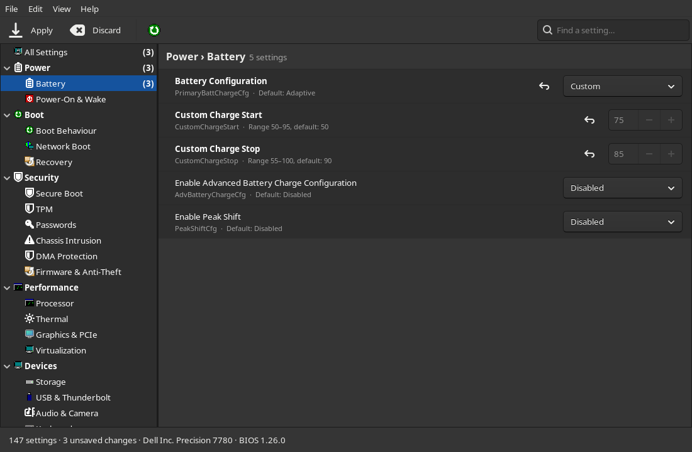
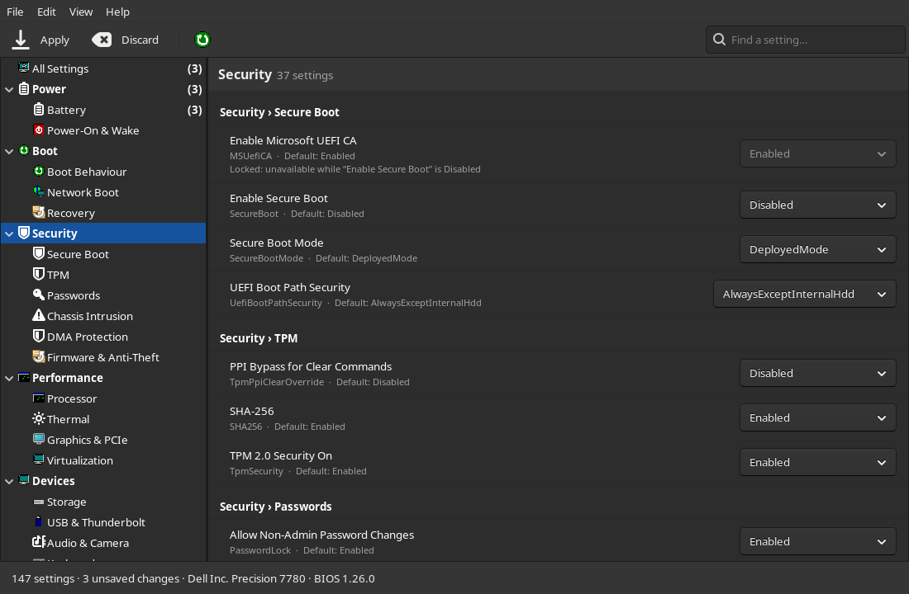
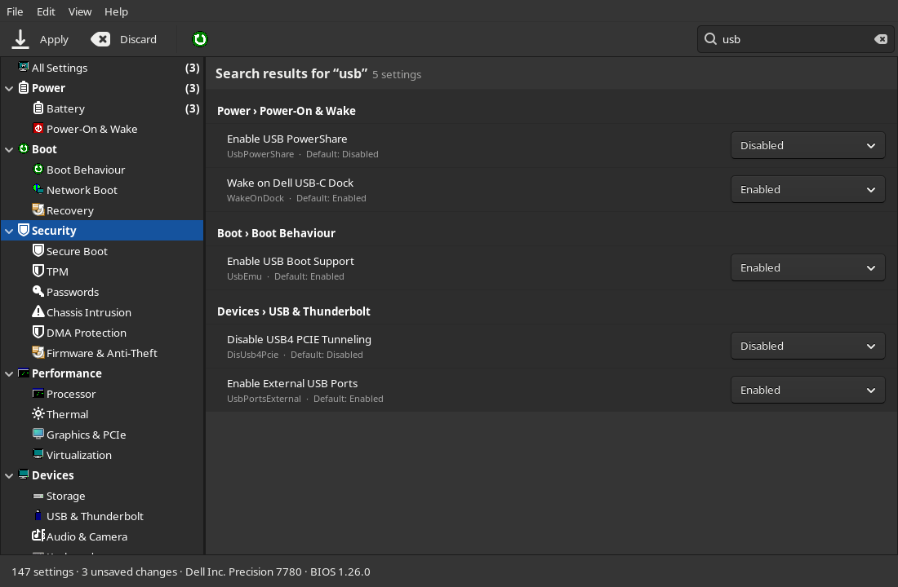
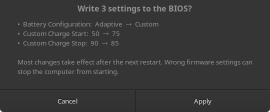

# Dell BIOS Settings

**Change your Dell's BIOS setup from a running Linux desktop. No reboot into F2 needed.**

A native GTK 3 app in the spirit of Thunar: a menu bar, a toolbar, a section tree
on the left and the settings on the right. It uses your GTK theme, icon theme and
window decorations, and draws nothing of its own.




## Features

- **Every BIOS setting your Dell offers.** Battery charge limits, boot options,
  Secure Boot, TPM, virtualization, CPU features, ports, wireless, keyboard
  backlight and more. A Precision 7780 offers 147 settings.
- **Sorted into sections.** Power, Boot, Security, Performance, Devices and
  Maintenance, each with subsections such as *Battery*, *Secure Boot*, *TPM* or
  *USB & Thunderbolt*. Click a section to see all of it, or a subsection to see
  just that part.
- **Nothing is written until you click Apply.** Changes are staged, shown in bold
  and counted in the sidebar. They are also listed under *Unsaved Changes*, and
  each one can be undone on its own. Before anything is written, a confirmation
  lists every change as old value → new value.
- **Follows the BIOS's own rules.** A setting that depends on another unlocks
  live. For example, *Custom Charge Start* stays locked until *Battery
  Configuration* is *Custom*. Settings that others depend on are written first,
  so a whole change set applies in one go.
- **Find a setting** by its name or its BIOS attribute name (<kbd>Ctrl</kbd>+<kbd>F</kbd>).
- **Reset to defaults** for the settings currently shown (Edit menu). This is
  staged as well and needs Apply.
- **Asks for the BIOS admin password** when one is set. It is used for that one
  write and then cleared.
- **Offers a restart** when the BIOS reports changes that take effect at the
  next boot.
- **One password prompt per session.** The window runs as you, and only a small
  helper runs as root (see [Security](#security)).

| A whole section | Search | Confirmation before writing |
|---|---|---|
|  |  |  |

<sub>The screenshots use demo values and the Adwaita-dark theme.</sub>

## Install

```sh
git clone https://github.com/KsmBl/DellBiosGTK.git
cd DellBiosGTK
./install.sh --check      # is this computer supported?
./install.sh --system     # install for everyone into /usr/local (recommended)
```

Then start **Dell BIOS Settings** from the application menu, or run `dell-bios-gtk`.

| Command | What it does |
|---|---|
| `./install.sh --system` | Install into `/usr/local` (asks for sudo). Recommended, because the root helper then belongs to root. |
| `./install.sh` | Install for your user only, into `~/.local`. |
| `./install.sh --prefix DIR` | Install into `DIR`. |
| `./install.sh --uninstall` | Remove the program; add `--system` if you installed it that way. |
| `./install.sh --check` | Only check whether this computer is supported. |
| `./dell-bios-gtk` | Run straight from the source folder, without installing. |

### Requirements

- Linux 5.11 or newer with the `dell-wmi-sysman` driver (built into all major
  distributions' kernels)
- Python 3 with PyGObject and GTK 3
- polkit (`pkexec`) and an authentication agent; every desktop has one

| Distribution | Command |
|---|---|
| Arch, Manjaro | `sudo pacman -S --needed python python-gobject gtk3 polkit` |
| Debian, Ubuntu, Mint | `sudo apt install python3 python3-gi gir1.2-gtk-3.0 policykit-1` |
| Fedora | `sudo dnf install python3 python3-gobject gtk3 polkit` |
| openSUSE | `sudo zypper install python3 python3-gobject-Gdk typelib-1_0-Gtk-3_0 polkit` |

## Supported computers

There is no fixed list of models. The kernel driver `dell-wmi-sysman` has no
model table. It loads on any Dell or Alienware computer whose BIOS offers
Dell's *WMI BIOS attribute* interface, and on every other computer it does
nothing. Dell built this interface for its business lines and its Windows tools
*Dell Command | Configure* and *Dell Command | PowerShell Provider*, but
publishes no per-model list for it.

| Product line | Supported? |
|---|---|
| **Latitude** laptops | Yes, models from about 2018 on |
| **Precision** mobile and tower workstations | Yes, models from about 2018 on |
| **OptiPlex** desktops | Yes, models from about 2018 on |
| **XPS** laptops | Most models from about 2018 on |
| **Dell Pro / Pro Max** (2025 successors of Latitude, Precision and OptiPlex) | Expected, same BIOS family |
| **Vostro**, **Inspiron**, **G-series**, **Alienware** | Usually not; some recent models expose a few settings |
| Dells from before about 2018 | Usually not |
| PowerEdge servers | No (they use iDRAC instead) |

The years and the XPS / Pro / Alienware entries are estimates, not an official
list. **Tested on:** Dell Precision 7780 (BIOS 1.26.0, 147 settings). Reports
from other models are welcome. Please open an issue with the model and whether
it worked.

To check a computer, run `./install.sh --check`, or look for the folder yourself:

```sh
ls /sys/class/firmware-attributes/dell-wmi-sysman/attributes
```

If the folder is missing, load the driver with `sudo modprobe dell-wmi-sysman`.
If it is still missing after that, the BIOS does not offer the interface;
sometimes a BIOS update adds it.

Which settings appear, and their names, come from the BIOS itself, so they
differ between models. Settings the app does not recognise appear under
*Other*.

## Example: battery charge limits

By default many Dells use *Adaptive* charging, where the BIOS decides when to
charge. If you want the battery to stop at, say, 85% to make it last longer:

1. Open **Power › Battery**.
2. Set **Battery Configuration** to **Custom**. *Custom Charge Start* and *Custom
   Charge Stop* unlock.
3. Set them, for example to 75 and 85, and click **Apply**.

The new limits apply right away, and Linux shows them in
`/sys/class/power_supply/BAT0/charge_control_*_threshold`.

## How it works

The kernel's `dell-wmi-sysman` driver exposes each BIOS setting as a folder
under `/sys/class/firmware-attributes/dell-wmi-sysman/attributes/`. Each folder
holds the setting's display name, type, allowed values, default and dependency
rules. The current value can only be read and written by root.

```
dell-bios-gtk (runs as you, GTK 3)
   │  JSON lines over a pipe
   ▼
helper.py (runs as root, started once via pkexec)
   │  reads / writes only inside the firmware-attributes folder
   ▼
/sys/class/firmware-attributes/dell-wmi-sysman/  →  BIOS (WMI)
```

## Security

- Only `dellbiosgtk/helper.py` runs as root. It accepts two requests, *read
  everything* and *set these attributes*. It checks every name against the
  attributes the BIOS lists and rejects values with line breaks. It never
  touches files outside the firmware-attributes folder.
- The BIOS admin password, when needed, is written to the driver right before
  the change and cleared right after. It is never stored.
- Install with `./install.sh --system`. That way the helper belongs to root
  and cannot be modified by a program running under your account.

## Caution

These are real firmware settings. Wrong values, for example for Secure Boot, the
SATA/RAID mode or the TPM, can stop the computer from booting. They can also
lock disks encrypted with BitLocker or a TPM-bound LUKS key. Most changes take
effect after a restart, and until then you can change them back. If something
does go wrong, you can still fix it in the normal BIOS setup (F2 at boot).

## Development

Run against a fake copy of the sysfs tree, without root or pkexec:

```sh
DELLBIOS_ROOT=/path/to/fake/dell-wmi-sysman ./dell-bios-gtk
```

The tree needs the same layout as the real one:
`attributes/<Name>/{type,current_value,possible_values,…}`, plus
`authentication/Admin/is_enabled`. The sections shown in the sidebar are
defined in `SECTIONS` in `dellbiosgtk/app.py`.

## License

[GNU General Public License v3.0](LICENSE)
